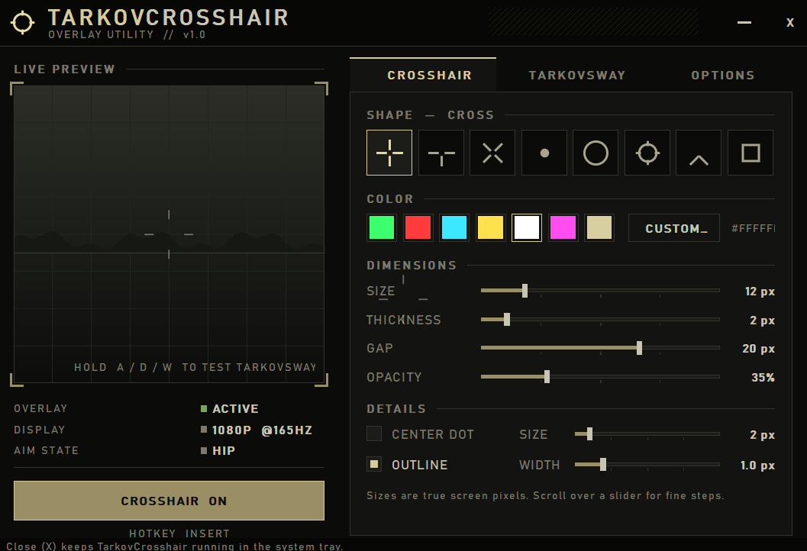

# TarkovCrosshair

<p align="center">
  <b>A lightweight, high-performance customizable crosshair overlay built for Escape from Tarkov.</b>
</p>

<p align="center">
  
  
  
  <a href="https://buymeacoffee.com/g.hostproxy"></a>
</p>

<p align="center">
  <a href="https://github.com/g-hostproxy/TarkovCrosshair/releases/latest/download/TarkovCrosshair.exe"><b>⬇️ Download TarkovCrosshair.exe</b></a>
  &nbsp;|&nbsp;
  <a href="https://g-hostproxy.github.io/TarkovCrosshair/">Website</a>
</p>

---

<p align="center">
  
</p>

---

## 📌 Overview

**TarkovCrosshair** is a clean, low-overhead desktop overlay designed to assist with point-firing, hip-fire alignment, and close-quarters engagements in *Escape from Tarkov*. It's a single ~125 KB `.exe` with no installer and no dependencies, and it runs alongside the game without impacting framerates.

Its **TarkovSway** motion was calibrated frame by frame against an in-game laser, so the crosshair leans, dips and kicks the way your weapon does.

---

## ✨ Key Features

* **Fully Customizable Visuals:** 8 shapes (cross, T, X, dot, circle, reticle, chevron, box), size, thickness, gap, opacity, centre dot, outline and any colour, for clear visibility across varying raid lighting and weather.
* **Hide When Aiming:** Hides the crosshair on right-click, with Hold, Toggle or Tarkov (tap to toggle, hold to hold) modes.
* **TarkovSway:** Strafing makes the crosshair lean against your movement; walking forward dips it, walking back lifts it. It responds about 235 ms after your keys, measured against an in-game laser.
* **Recoil & Dynamic Spread:** A visual climb when you fire (semi or full auto, adjustable fire rate, kick and recovery), and a gap that opens while you move and shoot. Visual only: your mouse is never moved.
* **Presets:** A locked, laser-calibrated **Tarkov Default**, plus 3 slots you can tune per gun. Slots save automatically.
* **Zero Performance Impact:** Single thread, idles at ~0% CPU, draws only when something changes, and removes itself from the screen while hidden.
* **Instant Hotkey Toggle:** Show or hide the overlay mid-raid with a configurable global hotkey (default `Insert`).
* **External Overlay Architecture:** A separate click-through window. It never reads, writes or injects into the game, uses no hooks or drivers, and stays visible to screenshots and recordings.

---

## 🚀 Installation & Quick Start

1. Head over to the [Releases](../../releases) page and download `TarkovCrosshair.exe` (or the zip package).
2. Put it anywhere you like (extract the zip first if you downloaded that).
3. Run `TarkovCrosshair.exe`. Windows SmartScreen may warn because the app is unsigned: click **More info → Run anyway**.
4. Configure your crosshair, sway and keybinds in the settings window. Closing it keeps the app running in the system tray.
5. In *Escape from Tarkov*, set **Screen mode → Borderless**, then deploy.

> **Note:** No overlay can draw over exclusive **Fullscreen** mode. Use **Borderless**.

---

## ⚙️ Configuration

Preferences are managed in the settings window and saved automatically to `%APPDATA%\TarkovCrosshair\settings.ini`:

* **Hotkeys:** Assign a custom keybinding to toggle visibility, and match the movement keys to your Tarkov binds.
* **Color & Style:** Pick a swatch or any custom colour, then set thickness, gap and outline.
* **Presets:** Switch between Tarkov Default and your 3 slots. Each slot stores sway, recoil and spread together.

---

## ⚠️ Anti-cheat

TarkovCrosshair is built to be as passive as possible. It only reads which keys are held and draws in its own window; it never touches the game process or its files. **No third-party tool can be guaranteed ban-safe**, though. Battlestate's terms forbid software that gives an unfair advantage, and they decide what counts. Use it at your own risk.

---

## 🛠️ Building from Source

If you prefer to build the binary yourself:

1. Clone the repository:
   ```bash
   git clone https://github.com/g-hostproxy/TarkovCrosshair.git
   ```
2. Install [MinGW-w64](https://www.mingw-w64.org/) or [llvm-mingw](https://github.com/mstorsjo/llvm-mingw) and put it on your `PATH`.
3. Run `build.bat` (Windows) or `make` (MinGW/Linux cross-compile). The exe is written to `build\TarkovCrosshair.exe`.

| File | What it is |
| --- | --- |
| `src/core.h` | Crosshair rasterizer, TarkovSway physics and recoil model (portable C) |
| `src/main.c` | Win32 overlay, input loop and settings window |
| `res/` | Icon, manifest and version info |
| `docs/` | The download website (GitHub Pages) |

---

## ☕ Support

If TarkovCrosshair helps your raids, you can support development here:

<a href="https://buymeacoffee.com/g.hostproxy"></a>

---

*TarkovCrosshair is a fan-made tool and is not affiliated with or endorsed by Battlestate Games. Escape from Tarkov is a trademark of Battlestate Games.*
